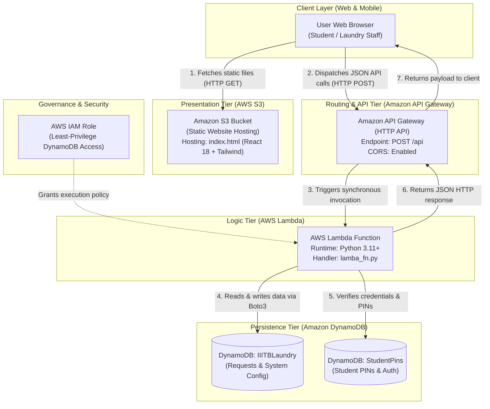
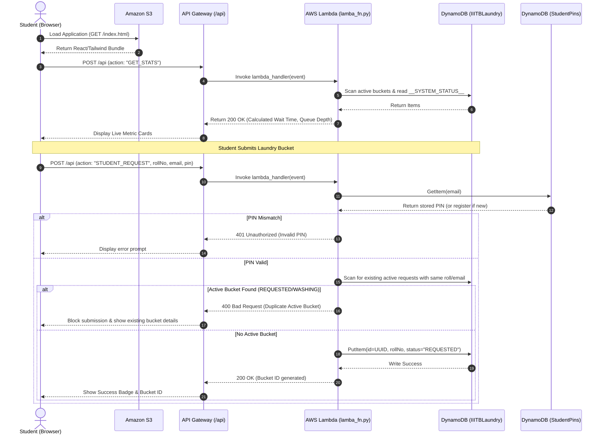

# IIIT BBSR Smart Laundry Management System
## Cloud Computing Project Report & System Architecture Specification

---

## 1. Executive Summary & Project Overview

The **IIIT BBSR Smart Laundry Management System** is a serverless, cloud-native web application designed to streamline and automate hostel laundry operations in college campuses. In traditional campus setups, students face unpredictable queues, manual token management, lack of visibility into washing machine availability, and long turnaround times. 

This project solves these operational bottlenecks by providing:
1. **Real-time Queue Visibility & Wait Time Forecasting**: Students can check how many buckets are currently washing, how many are queued, and the estimated completion time computed using queue depth and operational machine capacity.
2. **Staff Operational Command Center**: Laundry workers can monitor bucket submissions, progress clothes through states (`REQUESTED` &rarr; `APPROVED_WAITING` &rarr; `WASHING` &rarr; `READY` &rarr; `COLLECTED`), and broadcast machine breakdown/maintenance alerts.
3. **Duplicate Submission Protection**: A student cannot submit a new bucket until their active laundry is washed and collected.
4. **Zero-Build, Serverless Architecture**: Highly available, cost-effective (100% AWS Free Tier compliant), and requiring zero persistent server maintenance.

---

## 2. Cloud Architecture & How Everything Comes Together

The application is built on a **fully serverless, event-driven cloud architecture** on Amazon Web Services (AWS). It separates the presentation tier (frontend), logic tier (compute), and data tier (database) into loosely coupled, scalable managed services.



### Component Roles & Interaction:
1. **Amazon S3**: Acts as the content distribution origin. It stores and serves the single-page application ([index.html](file:///d:/major_projects/cloud_comp/index.html)) over standard web protocols with public read access.
2. **Amazon API Gateway (HTTP API)**: The single entry point for all frontend data traffic. It intercepts incoming HTTPS requests, applies CORS policies (`POST`, `OPTIONS`), and routes payloads to the Lambda handler.
3. **AWS Lambda**: The stateless compute brain. It executes [lamba_fn.py](file:///d:/major_projects/cloud_comp/lamba_fn.py) only when invoked, parsing actions, running business logic, and terminating once the response is dispatched.
4. **Amazon DynamoDB**: The NoSQL persistence layer. It provides millisecond response times to scan, retrieve, update, and persist bucket requests and credentials.
5. **AWS IAM**: Enforces security boundaries, ensuring Lambda has execution rights and granular access only to the two designated DynamoDB tables.

---

## 3. End-to-End Request & Data Lifecycle

The diagram below details the sequence of interactions when a student submits a laundry request:



---

## 4. Key Features & Functional Modules

### 4.1. Student Self-Service Portal
* **Automated PIN Authentication**: First-time users register their 4-digit PIN linked to their `@iiit-bh.ac.in` email. Subsequent submissions require this PIN, preventing unauthorized submissions under another student's identity.
* **Duplicate Submission Prevention**: Prevents students from hoarding washing capacity. A student is locked out of submitting a new bucket until their active item reaches `COLLECTED` or `COMPLETED`.
* **Real-Time Bucket Tracker**: Students can query their status anytime using their Roll Number or Email to view:
  * Current status badge (`REQUESTED`, `APPROVED_WAITING`, `WASHING`, `READY`).
  * Queue position (e.g., `#2 in queue`).
  * Estimated ready time in minutes.
  * Pickup notification alert when ready.

### 4.2. Laundry Staff & Administration Command Center
* **Machine Operational Controller**: Staff can update operational vs. total machines (e.g. `3 / 5 Working`).
* **Maintenance Notice Broadcasting**: Workers can publish real-time alerts (e.g., *"Machine #2 under motor maintenance. Expect 20 min delays"*). This immediately renders a prominent yellow alert banner across the student interface.
* **Stage Progression Engine**: Laundry staff transition buckets through defined states with single-click actions:
  $$\text{REQUESTED} \xrightarrow{\text{Queue}} \text{APPROVED\_WAITING} \xrightarrow{\text{Start Wash}} \text{WASHING} \xrightarrow{\text{Finish}} \text{READY} \xrightarrow{\text{Pickup}} \text{COLLECTED}$$

### 4.3. Dynamic Wait Time Forecasting Algorithm
Wait time is calculated dynamically in the Lambda backend using operational machine capacity and queue depth:

$$\text{Batches Ahead} = \left\lceil \frac{\text{Queued Ahead} + 1}{\max(1, \text{Working Machines})} \right\rceil$$
$$\text{Estimated Wait Time} = \text{Batches Ahead} \times \text{Cycle Duration (45 mins)}$$

If working machines drop to $0$, the system automatically displays `"Service Paused (Maintenance)"`.

---

## 5. Technical Implementation Details

### 5.1. Database Design (Amazon DynamoDB)

| Table Name | Partition Key | Schema Attributes | Purpose |
| :--- | :--- | :--- | :--- |
| **`IIITBLaundry`** | `id` (String) | `rollNo`, `email`, `status`, `date`, `last_updated` | Stores all laundry bucket requests and system metadata (`id: '__SYSTEM_STATUS__'`). |
| **`StudentPins`** | `email` (String) | `pin`, `rollNo` | Stores encrypted/hashed 4-digit student security credentials. |

> [!NOTE]
> **Single-Table Configuration Pattern**: The `IIITBLaundry` table stores a special item with `id = '__SYSTEM_STATUS__'` holding `total_machines`, `working_machines`, and `alert_message`. This eliminates the cost and latency of creating a separate configuration database.

### 5.2. Frontend Architecture ([index.html](file:///d:/major_projects/cloud_comp/index.html))
* **Technology**: React 18, Babel Standalone, Tailwind CSS 3.
* **Zero-Build Deployment**: All dependencies are loaded via high-availability CDNs. The entire client-side application exists in a single, deployable `index.html` file that requires no Node.js/Vite/Webpack build pipelines.
* **Responsive Glassmorphism UI**: Uses Tailwind's backdrop-filter utilities, high-contrast badges, mobile-responsive grids, and responsive tab switching.
* **Environment Auto-Detection**:
  ```javascript
  const API_URL = (window.location.hostname === 'localhost' || window.location.hostname === '127.0.0.1')
      ? 'http://localhost:8000/api'
      : 'https://5ff43oy8g1.execute-api.ap-south-1.amazonaws.com/api';
  ```
  Seamlessly switches between the local test harness and production AWS endpoints without code changes.

### 5.3. Backend Architecture ([lamba_fn.py](file:///d:/major_projects/cloud_comp/lamba_fn.py))
* **Technology**: Python 3.11+, Boto3 AWS SDK.
* **CORS Compliance**: Handles browser preflight `OPTIONS` requests and emits permissive headers (`Access-Control-Allow-Origin: *`).
* **Decimal Serialization**: Includes a custom `DecimalEncoder` subclassing `json.JSONEncoder` to seamlessly convert DynamoDB `Decimal` numbers into standard Python `int` and `float` types.

---

## 6. AWS Free Tier & Cost Breakdown

This architecture was designed to run **entirely within the AWS Free Tier**, incurring ₹0 / $0 monthly operational expense:

| Service | AWS Free Tier Quota | Project Utilization | Net Cost |
| :--- | :--- | :--- | :--- |
| **AWS Lambda** | 1,000,000 invocations / month | ~5,000 invocations / month | **$0.00** |
| **Amazon DynamoDB** | 25 GB storage + 25 WCU / 25 RCU | < 5 MB storage, On-Demand mode | **$0.00** |
| **Amazon S3** | 5 GB standard storage | ~35 KB (Single index.html file) | **$0.00** |
| **Amazon API Gateway** | 1,000,000 HTTP API calls / month | ~5,000 API calls / month | **$0.00** |
| **AWS IAM** | Always Free | 1 execution role | **$0.00** |
| **Total Monthly Cost** | — | — | **₹0.00 ($0.00)** |

---

## 7. Security & Best Practices

1. **Least-Privilege IAM Access**: Lambda runs under an IAM role restricted strictly to `dynamodb:*` operations on the designated application tables, preventing unauthorized access to other cloud resources.
2. **Input Validation**: Backend sanitizes and verifies student emails against the authorized academic domain (`@iiit-bh.ac.in`), enforces PIN minimum length, and upper-cases Roll Numbers for case-insensitive matching.
3. **Stateless Compute**: Lambda functions retain no state between calls; all transactions are committed atomically to DynamoDB, guaranteeing data consistency.
4. **Client-Side Graceful Degradation**: If backend connectivity fails, the frontend catches network errors and surfaces actionable feedback without application crashes.

---

## 8. Summary of Project Files

* [index.html](file:///d:/major_projects/cloud_comp/index.html) — Complete React 18 & Tailwind CSS frontend application.
* [lamba_fn.py](file:///d:/major_projects/cloud_comp/lamba_fn.py) — Serverless Python backend handler deployed to AWS Lambda.
* [local_test_server.py](file:///d:/major_projects/cloud_comp/local_test_server.py) — Built-in mock test server for zero-cloud local testing and verification.
